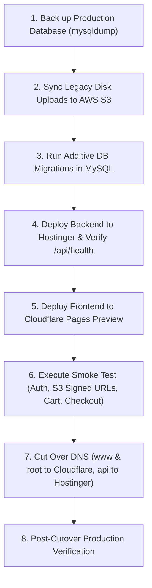

# Migration Plan – Honey Universal Services (`honeyuniversal.com`)

**Prepared by:** Mano Rakshahan  
**Scope:** Moving the application from legacy hosting to Hostinger (Backend API & MySQL) + Cloudflare Pages (Frontend SPA) + AWS S3 (Document Storage).

---

## 1. Executive Summary & Architecture Overview

| Component | Legacy Infrastructure | Target Infrastructure |
|---|---|---|
| **Frontend** | Monolithic server | **Cloudflare Pages** (Global CDN edge, fast static asset delivery, immutable cache) |
| **Backend API** | Legacy Node / cPanel | **Hostinger Node.js** (Node 18/20 LTS, application root `backend`, entry `server.js`) |
| **Database** | Legacy MySQL | **Hostinger Cloud / Remote MySQL** (`srv1118.hstgr.io`) |
| **Document Storage** | Local filesystem (`uploads/`) | **Private AWS S3 Bucket** (Server-Side Encryption `AES256`, short-lived presigned URLs) |
| **Email Service** | Local SMTP / cPanel mail | **Resend API** (SPF, DKIM, DMARC DNS verified) |
| **Payment Gateway** | Razorpay Test / Live | **Razorpay** (HMAC-SHA256 signature verification, webhook handling) |

---

## 2. Document Storage Migration Analysis (Critical Action)

### Current Production Backend Code Behavior
- In the audited codebase, **all new customer uploads are streamed in-memory directly to AWS S3**:
  - `backend/middleware/upload.js` uses `multer.memoryStorage()` with a strict 50 MB limit and MIME validation.
  - `backend/services/s3Service.js` and `backend/routes/s3Routes.js` put objects into the private S3 bucket (`AWS_S3_BUCKET_NAME`) under `documents/<userId>/<uuid>` or `uploads/<uuid>`.
  - Downloads are gated via `GET /api/orders/:id/download-completed-file`, requiring user authentication and generating 5-minute AWS S3 presigned URLs.
  - **No uploaded files are stored on the local server disk.**

### Legacy Live Server Documents vs. Target S3
- **Do existing documents need to be copied? YES.**
  - On the current live server, historical order files and customer-uploaded documents were saved to local disk (`uploads/` or `backend/uploads/`).
  - If existing documents are **not** copied to S3 during the move to Hostinger, customers and admins requesting downloads for past orders will receive a `404 / NoSuchKey` error from S3.
  - **Action Required:** Before cutting over traffic to Hostinger, all files in the current live server's `uploads/` directory must be synchronized to the target AWS S3 bucket.

### Legacy File Sync Procedure
Run the AWS CLI sync command from the live server:
```bash
# Sync all legacy uploads to the S3 bucket with AES256 server-side encryption
aws s3 sync /path/to/live/uploads/ s3://<AWS_S3_BUCKET_NAME>/uploads/ \
  --sse AES256 \
  --metadata-directive COPY
```
*Note: Verify that the IAM user credentials used for this sync match the `AWS_ACCESS_KEY_ID` configured in the backend environment.*

---

## 3. Hostinger Deployment Specifications

### Node.js Application Configuration (hPanel)
In Hostinger hPanel (**Websites → Manage → Advanced → Node.js**):
- **Node.js Version:** `18.x` or `20.x` LTS
- **Application Root:** `backend` (or `public_html/backend` if full repo is cloned)
- **Application Startup File:** `server.js` (alias `index.js` also supported)
- **Start Command:** `npm start` (or `node server.js`)
- **Health Verification:** `GET https://<api-domain>/api/health` must return `200 OK`

### Environment Variables (Hostinger)
Configure the following in the Hostinger Node.js environment or `backend/.env`:
```ini
PORT=3000
NODE_ENV=production
FRONTEND_URL=https://honeyuniversal.com,https://www.honeyuniversal.com
BACKEND_PUBLIC_URL=https://api.honeyuniversal.com
MYSQL_HOST=srv1118.hstgr.io
MYSQL_PORT=3306
MYSQL_USER=<DB_USER>
MYSQL_PASSWORD=<DB_PASSWORD>
MYSQL_DATABASE=<DB_NAME>
JWT_SECRET=<STRONG_RANDOM_SECRET>
SESSION_SECRET=<STRONG_RANDOM_SECRET>
GOOGLE_CLIENT_ID=<GOOGLE_CLIENT_ID>
GOOGLE_CLIENT_SECRET=<GOOGLE_CLIENT_SECRET>
GOOGLE_CALLBACK_URL=https://api.honeyuniversal.com/api/auth/google/callback
AWS_REGION=ap-south-1
AWS_ACCESS_KEY_ID=<AWS_KEY_ID>
AWS_SECRET_ACCESS_KEY=<AWS_SECRET_KEY>
AWS_S3_BUCKET_NAME=<BUCKET_NAME>
RAZORPAY_KEY_ID=rzp_live_<KEY>
RAZORPAY_KEY_SECRET=<SECRET>
RAZORPAY_WEBHOOK_SECRET=<WEBHOOK_SECRET>
RESEND_API_KEY=re_<KEY>
RESEND_FROM_EMAIL=Honey Translations <noreply@honeyuniversal.com>
ADMIN_EMAIL=marketing@honeytranslations.com
ADMIN_NOTIFICATION_EMAIL=marketing@honeytranslations.com
```

---

## 4. Cloudflare Pages Deployment (Frontend)

1. Connect the GitHub repository `MarketingTeam12/Honey_Ecommerce_Website` to Cloudflare Pages.
2. Build Settings:
   - **Framework preset:** `Vite`
   - **Root directory:** `frontend`
   - **Build command:** `npm run build`
   - **Build output directory:** `dist`
3. Environment Variables:
   - `VITE_API_BASE_URL`: `https://api.honeyuniversal.com`
   - `VITE_RAZORPAY_KEY_ID`: `rzp_live_...` (or test key for staging preview)
4. Confirm `_headers` are applied:
   - `/*` sets `Cache-Control: no-cache, no-store, must-revalidate`
   - `/assets/*` sets `Cache-Control: public, max-age=31536000, immutable`

---

## 5. Step-by-Step Migration Execution Sequence



### Rollback Plan
- **Frontend:** Instantly roll back to previous deployment ID in Cloudflare Pages dashboard.
- **Backend:** Revert to previous Git release tag in Hostinger Node.js manager.
- **Database:** Restore from pre-migration `mysqldump` backup file.
